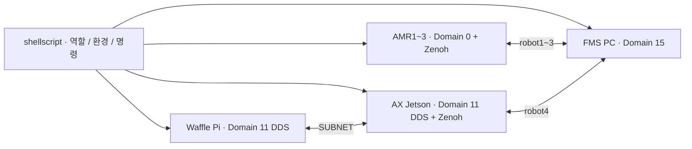

# shellscript

**LOGIFLOW · 메인 PC·AMR·Waffle·AX Jetson의 환경과 실행 명령을 맞추는 공통 스크립트**

장비마다 다른 ROS 도메인·통신 방식·작업공간을 반복해서 설정하지 않도록 설치기와 셸 명령을 모은 저장소다. AMR 1~3, FMS 메인 PC, WAF의 Pi·Jetson 역할을 구분하고 필요한 통신 패키지와 실행 함수를 준비한다.

주행·로봇팔·비전 알고리즘은 각 장비 저장소에 있다. 이 저장소는 환경 등록, 기존 실행 명령 호출, WAF 서비스 관리와 네트워크 설정을 담당한다.

[개요](#1-프로젝트-개요) · [기능](#2-주요-기능) · [연결](#3-시스템-연결) · [환경](#4-실행-환경) · [구조](#5-저장소-구조) · [설치](#6-설치-및-환경-설정) · [사용](#7-사용-방법) · [운영](#8-설정과-운영-시-참고) · [점검](#9-확인-및-점검) · [문서](#10-관련-문서와-저장소) · [브랜치](#11-브랜치와-문서-기준)

## 1. 프로젝트 개요

여러 장비가 각각 정상이어도 Domain·RMW·namespace·작업공간이 다르면 하나의 시스템으로 연결되지 않는다. 장비의 역할을 정해 같은 방식으로 환경을 불러오고, 현장에서 자주 쓰는 실행·상태·종료 명령을 줄이는 것이 목적이다.

| 장비 | 역할 |
|---|---|
| FMS PC | Zenoh Router·Bridge 등 메인 통신 환경 |
| TurtleBot1~3 | AMR 내부 ROS 환경과 robot1~3 Bridge |
| Waffle Pi | WAF Bringup·카메라, Domain 11 DDS |
| AX Jetson | WAF Nav2·비전·액션, robot4 Zenoh 연결 |

## 2. 주요 기능

- **설치 보조:** 기존 ROS 2 Jazzy 장비에 역할별 RMW·Zenoh 패키지 준비.
- **환경 등록:** `.bashrc` 관리 블록과 백업, 호스트명·계정·명시 역할을 통한 WAF 프로필 선택.
- **통신 모드:** AMR의 일반 DDS/로컬 Zenoh, WAF의 Domain 11 SUBNET 구성을 구분.
- **단축 실행:** Bringup·Nav2·카메라·Bridge·팔레트 액션 서버 실행 명령.
- **WAF 자동 시작:** Pi 2개·Jetson 3개 사용자 systemd 서비스 설치·시작·정지·로그 조회.
- **운영 점검:** 적용된 ID·역할·도메인·RMW 확인과 로컬 프로세스 정리.
- **네트워크 보조:** NetworkManager·Netplan 기반 Wi-Fi·고정 IP 설정 도구.

## 3. 시스템 연결



| 장비·모드 | Domain | RMW | Discovery | FMS 연결 |
|---|---|---|---|---|
| AMR1~3 `ros_local` | 0 | CycloneDDS | LOCALHOST | 각 로봇의 Zenoh Bridge |
| AMR1~3 `ros_normal` | 30/31/32 | FastDDS | SUBNET | 일반 DDS 모드 |
| FMS `ros_local` | 15 | CycloneDDS | LOCALHOST | 메인 Router·Bridge |
| Waffle Pi·AX Jetson | 11 | CycloneDDS | SUBNET | Jetson에서만 robot4 Bridge |

WAF 프로필에서는 `ros_local`을 실행해도 Domain 11·SUBNET을 유지하고 localhost 제한을 해제한다. Waffle Pi에 Zenoh Bridge를 띄우는 구성이 아니다.

## 4. 실행 환경

| 항목 | 구성 |
|---|---|
| 운영체제·셸 | Ubuntu 24.04, Bash |
| ROS | ROS 2 Jazzy가 먼저 설치된 장비 |
| 지원 환경 | 메인 PC, aarch64 로봇·Jetson |
| 통신 패키지 | CycloneDDS·FastDDS, Zenoh ROS2DDS Bridge 1.9.0 |
| 권한 | 패키지 설치·APT 저장소·linger 등록 시 sudo |
| 사전 작업공간 | AMR·WAF·카메라 등의 소스·빌드·장비 설정 별도 준비 |

설치기는 모든 로봇 모델·펌웨어·비전 가중치까지 준비하지 않는다. 설치·역할 등록과 로봇 실행을 구분한다.

## 5. 저장소 구조

```text
shellscript/
├── logitlebash.sh                 # 장비별 환경과 공통 실행 함수
├── scripts/main/                  # 메인 PC 통신 패키지·셸 환경
├── scripts/robot/                 # AMR 설치·환경 등록·백업
├── scripts/waffle/
│   ├── detect_role.sh             # Pi / Jetson 역할 판별
│   ├── environment.sh             # WAF 환경·실행 함수
│   ├── bridge.json5               # robot4 허용 인터페이스
│   ├── install.sh                 # 역할별 통신 설치·셸 등록
│   ├── run_service.sh             # 서비스 실행 진입점
│   └── service.py                 # WAF 사용자 systemd 관리
├── scripts/setup.sh               # FMS 구조를 전제로 한 통합 설치 보조
├── scripts/verify_env.sh           # FMS 환경 확인 보조
├── setup_wifi.sh                  # NetworkManager 네트워크 설정
├── setup_wifi_static.sh           # Netplan 고정 IP 설정
├── set_wifi_static.sh             # 기존 Netplan 도구
├── tests/                         # 환경·역할·서비스 가상 검증
└── docs/                          # 상세 운영 참고
```

## 6. 설치 및 환경 설정

### 저장소 받기

```bash
git clone --branch dev https://github.com/E1I6-Logistics/shellscript.git ~/shellscript
cd ~/shellscript
```

기존 장비는 로컬 변경을 확인한 뒤 현재 `dev`를 갱신한다. 아래 역할별 설치 중 해당 장비의 절차를 사용한다.

### AMR1~3

```bash
cd ~/shellscript
bash scripts/robot/install_robot.sh
source ~/.bashrc
robot_info
```

설치기는 필요한 통신 패키지를 설치하고 공통 환경을 등록한다. AMR 프로필의 작업공간 기본 경로는 `~/logitle_ws`, 보조 TurtleBot 작업공간은 `~/turtlebot3_ws`다. `turtlebot1`~`turtlebot3` 호스트명으로 장비 ID를 선택한다.

### Waffle Pi

```bash
cd ~/shellscript
bash scripts/waffle/install.sh --role pi
unset WAF_WS
source ~/.bashrc
robot_info
```

### AX Jetson

```bash
cd ~/shellscript
bash scripts/waffle/install.sh --role jetson
unset WAF_WS
source ~/.bashrc
robot_info
```

WAF의 기본 경로는 Pi `~/Logistics_WAF_RASPI`, Jetson `~/Logistics_WAF`, 카메라 `~/camera_ws`, 비전 Python `~/venv/yolov3/bin/python`이다. `unset WAF_WS`는 이전 셸에 남은 공통 작업공간 값을 제거해 역할별 기본 경로를 선택하는 절차다.

이미 패키지가 설치되어 있으면 WAF 설치에 `--env-only`를 추가해 환경 등록만 수행할 수 있다. `--role jetson`은 호스트명이 `localhost.localdomain`이어도 적용된다.

### 메인 PC

```bash
cd ~/shellscript
bash scripts/main/install_main.sh
```

이 명령은 메인 통신 패키지 설치용이다. FMS 전체 설치는 [Logistics_AI](https://github.com/E1I6-Logistics/Logistics_AI/tree/dev)의 `bash scripts/setup.sh main` 절차를 따른다. 이 저장소만 clone한 폴더에서 `scripts/setup.sh`를 FMS 전체 설치기로 실행하지 않는다.

## 7. 사용 방법

### AMR 실행

별도 터미널 두 개에서 `ros_local`, `sl`로 환경을 준비한 뒤 각각 `logibring`, `logizenoh`를 실행한다.

| 명령 | 역할 |
|---|---|
| `ros_local` / `ros_normal` | 현재 장비 프로필의 통신 모드 선택 |
| `sl` / `st` | 작업공간 환경 읽기 |
| `logibring` | AMR 통합 Bringup |
| `loginav2` | Nav2 단독 실행 |
| `logicam` | 카메라 실행 |
| `logizenoh` | AMR Bridge 실행. 기본 Router IP는 현장 예시 `192.168.0.16` |
| `robot_info` | 현재 로봇 환경 조회 |

메인 PC 주소가 다르면 AMR에서 직접 `ros2 launch zenoh_pkg zenoh.launch.py robot_id:=robot1 router_ip:=<FMS_PC_IP>`로 실행하거나 등록된 함수 인자를 확인한다.

### WAF 실행

단축 명령은 장비별로 분리되어 있다. 각 프로그램은 별도 터미널 또는 서비스로 실행한다.

| 장비 | 명령 | 실행 대상 |
|---|---|---|
| Pi | `wafbring` | Waffle 구동부 |
| Pi | `wafcamera` | 카메라 관리자 |
| Jetson | `wafnav2` | Nav2·지도·keepout |
| Jetson | `wafreplace` | 비전·팔레트 액션 서버 |
| Jetson | `logizenoh <FMS_PC_IP>` | Domain 11 ↔ robot4 Zenoh |
| 공통 | `wafnetwork`, `wafsource` | WAF 통신 환경·작업공간 재적용 |
| 공통 | `wafgoal 1` | 실제 팔레트 교체 요청 |

SSH의 비대화형 셸에서는 환경 파일을 직접 읽을 수 있다. 다음은 실행 예시이며 서비스가 이미 켜져 있으면 중복 실행하지 않는다.

```bash
ssh -t ax_logistics@192.168.0.100 \
  'source ~/shellscript/logitlebash.sh && wafreplace'
```

### WAF 부팅 자동 시작

역할 등록과 기존 수동 실행 종료를 마친 뒤 Pi·Jetson에서 각각 한 번 등록한다.

```bash
sudo loginctl enable-linger "$(id -un)"
waf_service autostart
```

| 관리 목적 | 선택할 명령 |
|---|---|
| 상태 조회 | `waf_service status` |
| 로그 보기 | `waf_service logs --follow` |
| 현재 실행 정지 | `waf_service stop` |
| 다시 시작 | `waf_service start` |
| 정지 후 재실행 | `waf_service restart` |
| 다음 부팅 자동 시작 해제·등록 | `waf_service disable` / `waf_service enable` |
| 변경한 경로·환경을 서비스에 저장 | `waf_service install` 후 필요한 시점에 재시작 |

표의 관리 명령은 필요한 것 하나씩 사용한다. `stop → start → restart`를 한꺼번에 실행하는 설치 순서가 아니다. 로그 보기에서 Ctrl+C는 로그 조회만 종료한다.

## 8. 설정과 운영 시 참고

- **서비스 범위:** Pi는 Bringup·카메라 관리자, Jetson은 Nav2·팔레트 서버·Zenoh를 관리한다. 부팅 시 보충 goal을 자동 전송하지 않는다.
- **경로 재정의:** `WAF_WS`, `WAF_CAMERA_WS`, `WAF_PYTHON`, `WAF_MAP`, `WAF_MASK`, `WAF_NAV_PARAMS`, `ZENOH_ROUTER_IP`를 사용한다. 변경 후 서비스에 다시 저장해야 한다.
- **Bridge 범위:** WAF는 배터리·AMCL·logitle_pose와 `/pallet_replace`만 중계한다. 내부 `/scan`·`/tf`·카메라·속도 제어는 Domain 11 DDS로 연결한다.
- **실행 상태:** systemd의 `active` 직후에는 ROS 환경을 읽는 중일 수 있다. Nav2 활성화·카메라 관리자·액션 서버 준비까지 로그로 확인한다.
- **프로세스 정리:** `roskill`은 해당 호스트의 넓은 ROS/Zenoh 프로세스 범위를 종료하는 도구다. WAF 서비스 관리에는 먼저 `waf_service stop`을 사용한다.
- **네트워크 설정:** Wi-Fi·고정 IP 변경 도구는 실제 연결을 바꾼다. 기존 현장 설정을 확인하고 필요할 때만 사용한다. 자격 정보는 README에 기록하지 않는다.

## 9. 확인 및 점검

```bash
robot_info
printf 'Domain=%s RMW=%s Discovery=%s\n' \
  "$ROS_DOMAIN_ID" "$RMW_IMPLEMENTATION" "$ROS_AUTOMATIC_DISCOVERY_RANGE"
```

WAF 서비스 상태·로그는 해당 장비의 `waf_service status`, `waf_service logs --follow`로 확인한다. 사용자 journal이 보이지 않으면 관리자 journal에서 해당 사용자·unit의 로그를 조회한다.

| 증상 | 확인 위치 |
|---|---|
| WAF가 Domain 0으로 설정됨 | 등록 역할, 오래된 셸 source, WAF 프로필 적용 순서 |
| Jetson을 알 수 없는 호스트로 표시 | `--role jetson` 등록, 계정명, 이전 `.bashrc` 설정 |
| Pi에서 Zenoh 실행 거절 | Jetson에서 `logizenoh`를 실행하는 역할 분리가 적용된 상태 |
| 작업공간·Python을 찾지 못함 | `WAF_*` 경로, 기존 빌드·가상환경 존재 여부 |
| 재시작 때 KeyboardInterrupt | 요청한 stop/restart 시각과 프로세스 종료 로그 |

개발 검증은 `python3 -m unittest discover -s tests -v`를 사용한다. 가상 검증은 실제 장비 실행·APT 설치·물리 동작 시험과 구분한다. 이번 정리에서는 설치기나 서비스를 실행하지 않는다.

## 10. 관련 문서와 저장소

- [상세 운영·SSH·서비스 참고](docs/README_REFERENCE.md)
- [FMS: Logistics_AI](https://github.com/E1I6-Logistics/Logistics_AI/tree/dev)
- [AMR: Logistics_AMR](https://github.com/E1I6-Logistics/Logistics_AMR/tree/dev)
- [WAF Jetson: Logistics_WAF](https://github.com/E1I6-Logistics/Logistics_WAF/tree/dev)
- [Waffle Pi: Logistics_WAF_RASPI](https://github.com/E1I6-Logistics/Logistics_WAF_RASPI)
- [로봇팔: Logistics_OMX](https://github.com/E1I6-Logistics/Logistics_OMX/tree/dev)

## 11. 브랜치와 문서 기준

2026-11-07 정리 기준은 최근 사용한 원격 `dev`의 `020ed11`이다. WAF Domain 11·Pi/Jetson 분리와 자동 시작을 포함한 실행 코드를 유지하고 README를 통일한다. **`main` 반영은 최종 검토·이미지 추가 후 별도로 진행한다.**

이번 정리에서 셸 함수·설치기·서비스 구현·Bridge 설정·네트워크 스크립트는 수정하지 않는다. 기존 상세 운영 문서는 참고본으로 보존한다.
